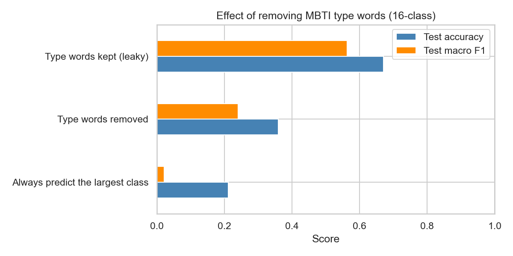
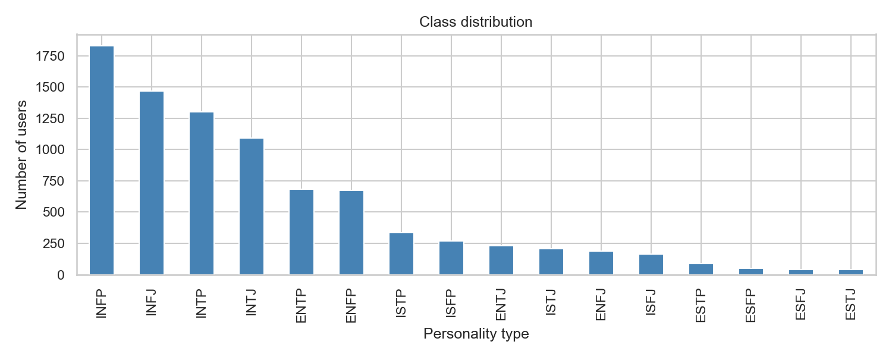
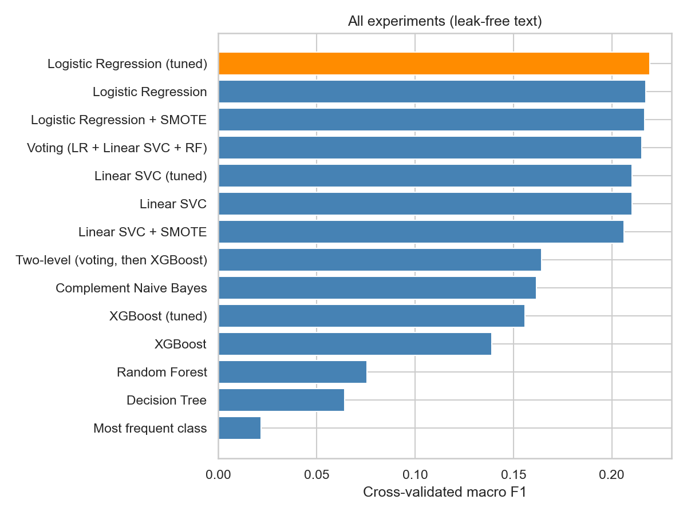
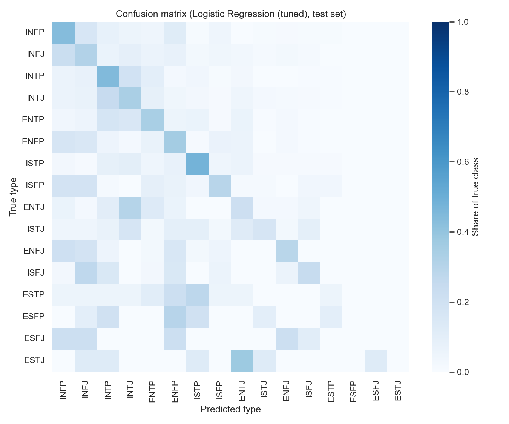
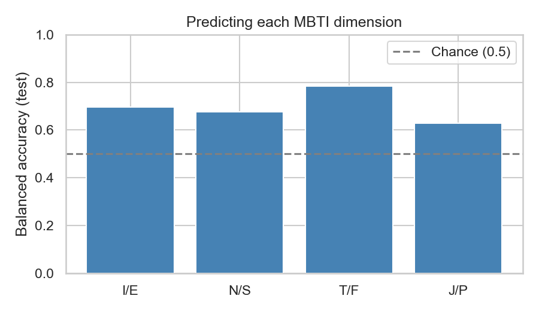

# MBTI Personality Prediction from Social Media Posts

Predicting a person's Myers-Briggs (MBTI) personality type from their forum posts with TF-IDF features and
classical machine learning models.

This project started as a course project that reported about 69% accuracy on 16 types. Revisiting it, I found
that 90% of users mention their own MBTI type in their posts, so the models were largely reading the answer.
After removing these words and evaluating with cross-validation, the best model reaches **36.0% accuracy**
(macro F1 0.241), compared with 21.1% for always predicting the most common type.



## Key Findings

- **Label leakage inflated the original results.** With the same model, removing type words lowers test
  accuracy from 67.1% to 36.0% and macro F1 from 0.563 to 0.241.
- **Writing style still carries some signal.** The leak-free model is clearly above the majority baseline,
  and Thinking vs. Feeling is the most predictable dimension (balanced accuracy 0.785).
- **Simple linear models work best on leak-free text.** Logistic regression outperforms XGBoost, random
  forest, voting, and a two-level classifier.
- **SMOTE does not improve on class weights** for handling class imbalance.

## Dataset

[(MBTI) Myers-Briggs Personality Type Dataset](https://www.kaggle.com/datasets/datasnaek/mbti-type) on Kaggle:
8,675 users from the PersonalityCafe forum, each with a self-reported MBTI type and their last 50 posts.

The classes are highly imbalanced: INFP has 1,832 users and ESTJ only 39.



## Method

1. **Cleaning**: lowercase, remove URLs and non-letter characters, and remove MBTI-specific terms: the 16 type
   names and their variants (`infjs`, `inxj`), temperament groups (`nf`, `nt`, `sj`, `sp`), and cognitive
   functions (`ni`, `fe`, `ti-dom`). After cleaning, no user's text contains a type name.
2. **Features**: TF-IDF with 5,000 features and English stop words removed.
3. **Evaluation**: an 80/20 stratified split. All model comparison and tuning use 5-fold cross-validation on
   the training set; TF-IDF and SMOTE run inside the pipeline so they only see training folds. The test set is
   used once for the final model.
4. **Metric**: macro F1, which weights all 16 types equally, alongside accuracy.

## Experiments

Each experiment from the original course project was repeated on leak-free text with cross-validation.

| # | Experiment | Original (test accuracy, with leakage) | Revised (CV macro F1, leak-free) |
|---|---|---|---|
| 1 | Compare models | XGBoost best, 68.5% | Logistic regression best, 0.217; XGBoost 0.139 |
| 2 | Add SMOTE | Logistic regression + SMOTE, 69.1% | 0.217 with SMOTE vs. 0.217 with class weights |
| 3 | Tune parameters | XGBoost, 68.6% | Logistic regression (C = 3), **0.219** |
| 4 | Voting | 55.9% | 0.215 |
| 5 | Two-level (group, then type) | 4 groups 74.4%; 16 types 57.9% | 4 groups 68.8% accuracy; 16 types 0.164 |



Tree-based models drop the most once type words are removed. Words like "infj" make very clean tree splits;
without them, the signal is spread across many ordinary words, which suits linear models better.

## Results

The selected model, tuned logistic regression, was evaluated once on the test set:

| | Accuracy | Macro F1 |
|---|---|---|
| Always predict INFP | 21.1% | 0.022 |
| **Logistic regression (leak-free)** | **36.0%** | **0.241** |
| Logistic regression (type words kept) | 67.1% | 0.563 |

Common types such as INFP, INTP, and ISTP reach F1 above 0.4. The three rarest types (ESFJ, ESFP, ESTJ) have
fewer than 10 test users each and are never predicted correctly.



### Predicting each dimension separately

| Dimension | Balanced accuracy | Example words |
|---|---|---|
| Thinking / Feeling | **0.785** | F: *feel, love, values, beautiful*; T: *knowledge, boring, stupid* |
| Introversion / Extraversion | 0.696 | I: *games, family, quiet, anime, nature*; E: *fun, crazy, guys, awesome* |
| Intuition / Sensing | 0.677 | N: *world, ideas, human, universe, books* |
| Judging / Perceiving | 0.629 | J: *plan, plans, help*; P: *lazy, theories, fun* |



## Limitations

- **Self-reported labels.** Types are what users chose to display on the forum, not results of a formal test.
- **A specific population.** PersonalityCafe users are interested in MBTI and often discuss it, so their writing
  may not represent the general public.
- **Some MBTI vocabulary remains.** Words like *intuition*, *inferior*, and *mbti* are still present after
  cleaning, so a small amount of forum-specific signal remains.
- **Bag-of-words features** ignore word order and context.
- **Very small classes.** Several types have fewer than 50 users in total.
- **MBTI itself** is a popular but debated personality framework.

## Future Work

- Use pretrained language model embeddings (for example, BERT) instead of TF-IDF
- Build a stricter MBTI vocabulary filter and measure how much each term contributes
- Evaluate on other MBTI datasets, such as those collected from Reddit

## Repository Structure

```
mbti-personality-prediction/
├── mbti_classification.ipynb   # Full analysis: leakage check, five experiments, final evaluation
├── figures/                    # Figures used in this README
├── data/                       # Dataset (not included)
└── requirements.txt
```

## How to Run

1. Install dependencies (Python 3.9 or later):

   ```bash
   python3 -m venv .venv
   source .venv/bin/activate
   pip install -r requirements.txt
   ```

   On macOS, XGBoost also needs OpenMP: `brew install libomp`.

2. Download `mbti_1.csv` from [Kaggle](https://www.kaggle.com/datasets/datasnaek/mbti-type) and save it as
   `data/mbti.csv`.

3. Open `mbti_classification.ipynb` and run all cells. A full run takes about 40 minutes on a laptop CPU, mostly
   for XGBoost.

## Project History

This was the final project for *Introduction to Artificial Intelligence* at Soochow University (Fall 2024). The original
course notebook is preserved in the [first commit](https://github.com/chlu03/mbti-personality-prediction/blob/40fcf17/mbti_original.ipynb).

In 2026 I revisited the project, identified the label leakage, and repeated all five experiments with
leak-free text, cross-validation, and macro F1.

## Team

- **Chun Hsiag Lu**: data preprocessing; Experiments 1 and 2 (model comparison and SMOTE); 2026 revised analysis
- Keng Hsien Lin
- Po Jui Huang
- Kuei Ting Chu
- Yu Feng Hou
